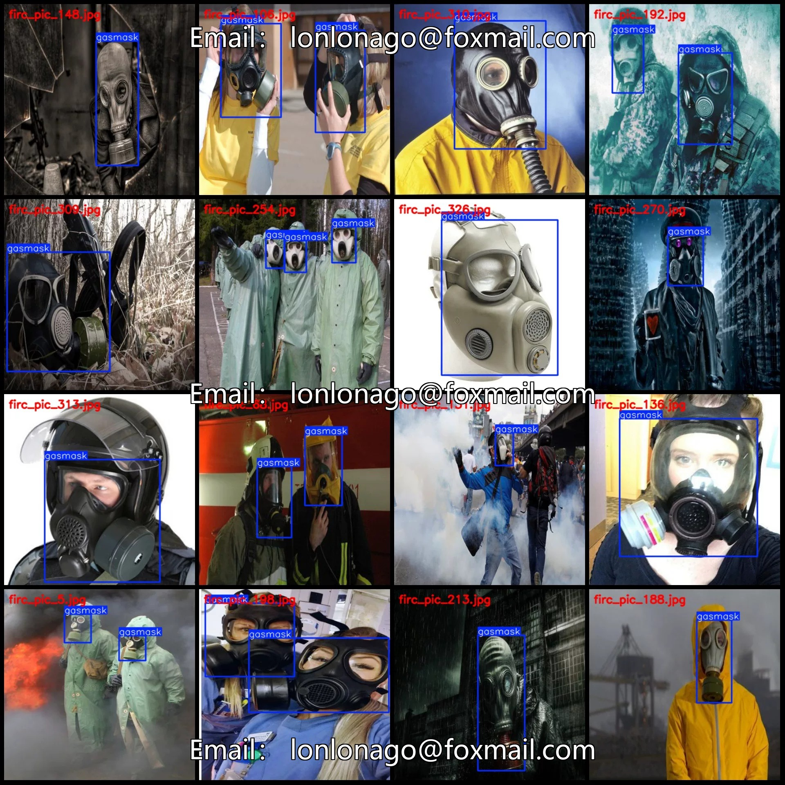
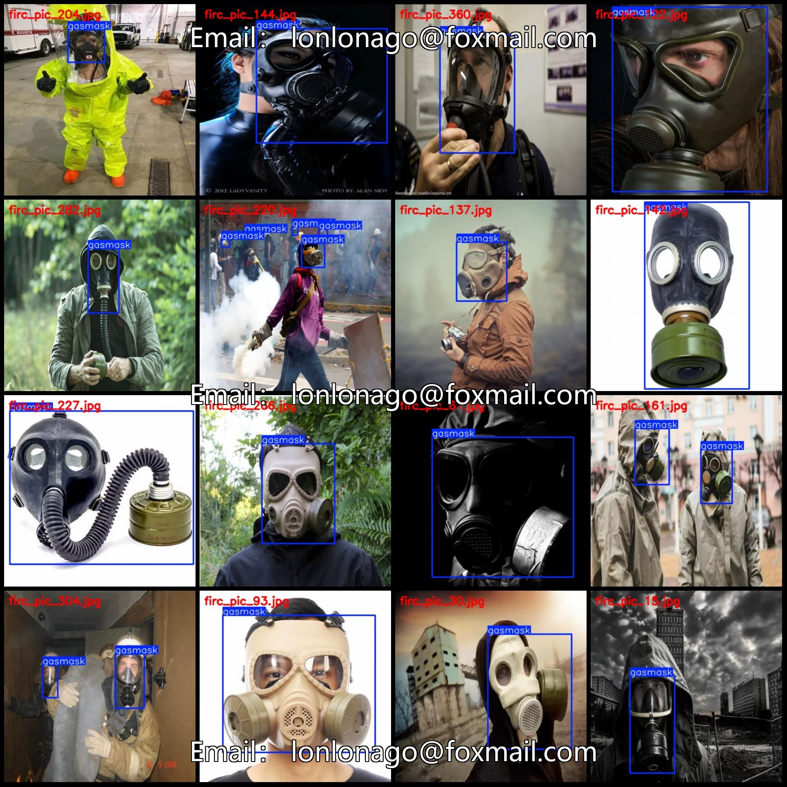
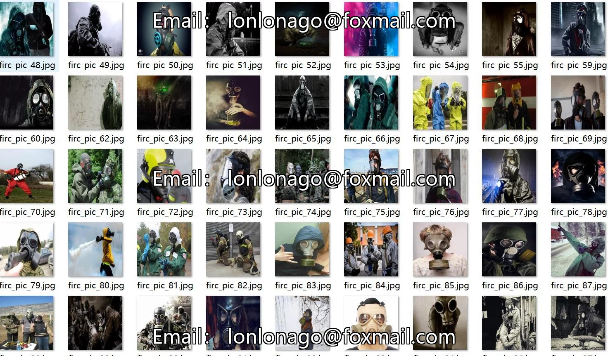
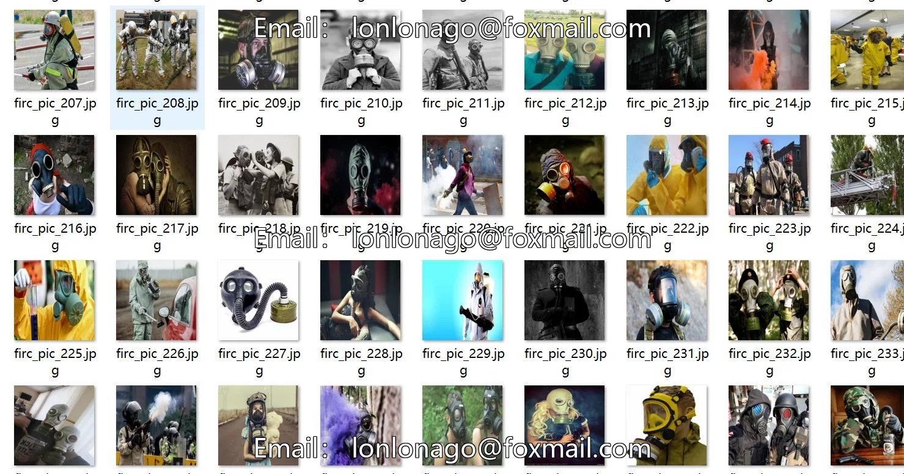
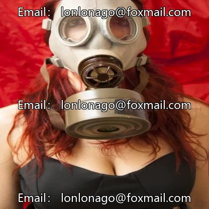
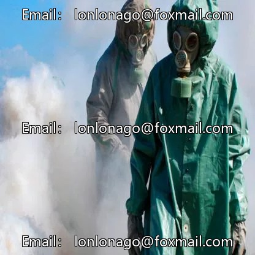
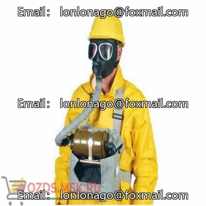

# Anti-virus mask detection dataset VOC+YOLO format with 361 images in 1 category

## Body

Precaution: Due to the dataset's replicability, please confirm compliance with requirements before purchasing.
Dataset format: Pascal VOC format + YOLO format (txt file without split path, only containing jpg images and corresponding VOC format xml files and yolo format txt files)
Number of images (number of jpg files): 361
Number of annotations (number of xml files): 361
Number of annotations (number of txt files): 361
Number of annotation categories: 1
Annotation category names: ["gasmask"]
Each category annotation box count and image count

Number of gasmask frames = 569, number of images occupied = 361
Total frame count: 569
Image resolution: 416x416
Labeling tool used: labelImg
Labeling rules: Draw a rectangle around the category.
Important note: The dataset does not include splits for training, validation, or testing; you need to manually divide it.
Special declaration: This dataset does not guarantee the accuracy of the trained models or weight files.

## Images

## Payment

Here is a pay link on Stripe ( https://buy.stripe.com/3cs8yP7sY87d0vu9AB ). Please contact me lonlonago@foxmail.com after funding $89, and I will send you a complete data files , thank you!

